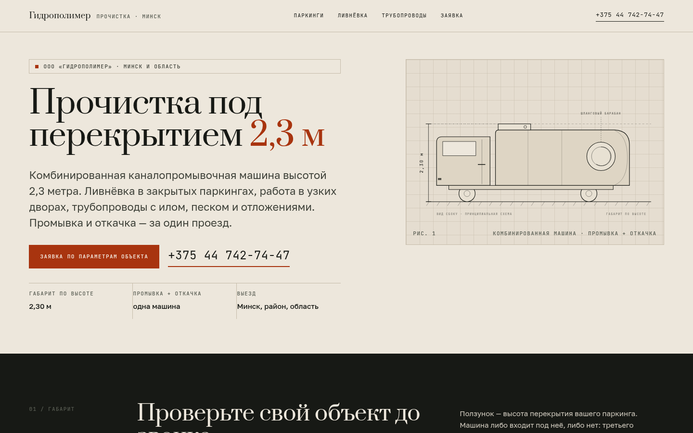

# gidropolimer — сайт ООО «Гидрополимер»

Одностраничный «паспорт услуги» + три раздела для гидродинамической прочистки труб и ливневых систем.
Ключевой аргумент компании вынесен в интерфейс: комбинированная каналопромывочная машина высотой **2,3 м**
проходит в закрытые паркинги, куда не заезжает типовая техника (≈3,3 м).

**Живой сайт:** https://romjjjke.github.io/gidropolimer/

## Стек

- React 18 + TypeScript + Vite
- react-router-dom (4 маршрута, SPA + `404.html`-фолбэк для GitHub Pages)
- GSAP + ScrollTrigger (появление блоков), Lenis (плавный скролл)
- Своя CSS-система на custom properties, 12-колоночная сетка, без UI-фреймворков
- Шрифты: Prata (дисплей) + Golos Text (текст) + JetBrains Mono (технические подписи)

## Локальный запуск

```bash
npm install
npm run dev      # http://localhost:5173/gidropolimer/
npm run build    # dist/
npm run preview
```

## Деплой

GitHub Actions (`.github/workflows/deploy.yml`) собирает проект на push в `main` и публикует `dist` в Pages.
Сборка копирует `index.html` в `404.html`, поэтому внутренние маршруты (`/parking`, `/livnevka`, `/truby`)
открываются напрямую, без ошибки 404.

## Скриншоты

| Десктоп 1440 | Мобильный 390 |
| --- | --- |
|  |  |

## Что внутри

- **Механика:** «габаритный тест» — ползунок высоты перекрытия, разрез паркинга и живой вердикт: проходит
  машина или нет, с запасом в сантиметрах.
- **Схема машины** нарисована в SVG: кабина, цистерна, шланговый барабан, размерная линия 2,30 м.
- **Заявка** собирает параметры объекта (перекрытие, диаметр трубы, тип сети) и открывает WhatsApp с готовым
  текстом; контактный телефон — прямой `tel:`-линк.
- SEO: уникальные `title`/`description` на каждой странице, Open Graph, JSON-LD `LocalBusiness`,
  `sitemap.xml`, `robots.txt`.
- Доступность: контраст ≥ 4,5:1, видимый фокус, `prefers-reduced-motion`, семантические теги, alt-тексты.

## Ограничения контента

Реальных фото объектов и опубликованного прайса у компании нет, поэтому: изображения — сдержанные
иллюстрации (макро струи, паркинг) с подписями «иллюстрация, не фото объекта», цены не выдуманы — вместо них
смета по параметрам заявки, отзывов нет вообще (не придумываем).
